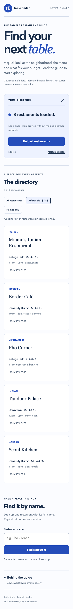
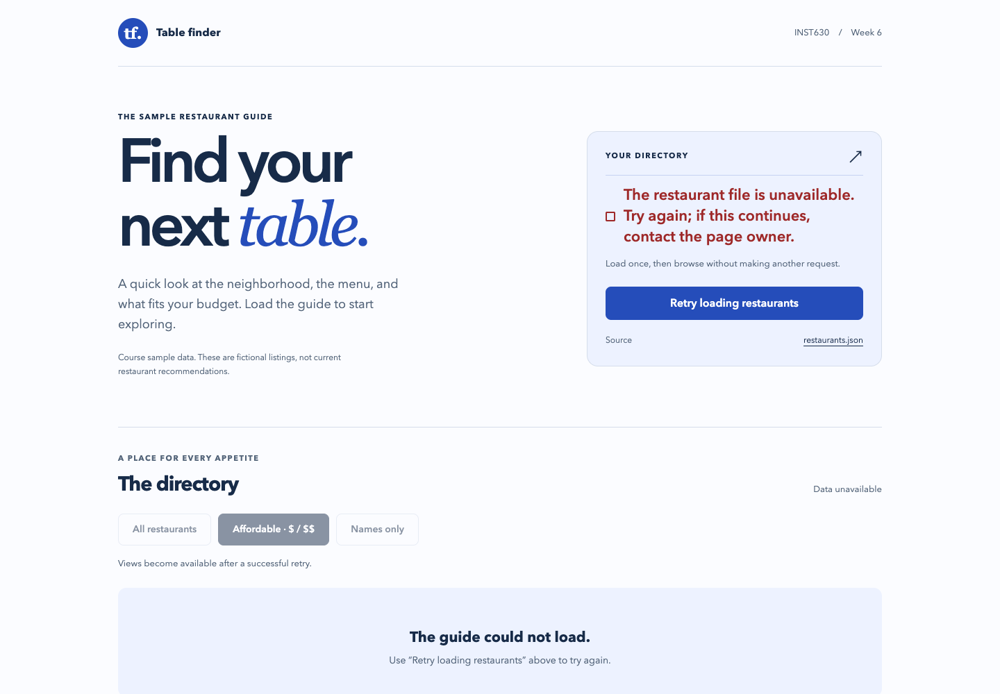

<p align="center">
  
</p>

<p align="center">
  <strong>An async JavaScript exercise with a complete request and recovery flow.</strong><br>
  Browse eight sample restaurants, narrow the list by price, or find a place by name.
</p>

<p align="center">
  
  
  
  
  <a href="https://github.com/kennethyeaher/asyncAndAPIs/actions/workflows/browser-checks.yml"></a>
</p>

<p align="center">
  <a href="#the-interaction">The interaction</a> &nbsp; · &nbsp;
  <a href="#class-requirements">Class requirements</a> &nbsp; · &nbsp;
  <a href="#run-locally">Run locally</a> &nbsp; · &nbsp;
  <a href="#verification">Verification</a>
</p>

---

## The interaction

An INST630 Week 6 project built from the supplied `tutorial_6_api` starter. The exercise moves restaurant records out of JavaScript and into a JSON file requested over HTTP. The interface shows what is happening while that request runs, enables browsing after validation, and offers a retry when loading fails.


<details>
<summary><strong>See the mobile layout and recovery state</strong></summary>
<br>
<p align="center"></p>

</details>

**The data is a course fixture.** These eight listings, ratings, prices, hours, and phone numbers are sample content from the starter, not current restaurant information. The page requests its own `restaurants.json`; it does not call a commercial restaurant API, store searches, or send them to another service.

## A short walkthrough

1. Choose **Load restaurants**. The request status changes to loading and the data controls stay disabled.
2. After the eight records load, browse **All restaurants** or **Affordable · $ / $$**. Five listings meet the affordable rule.
3. Choose **Names only** to see the same records transformed into a simple list.
4. Enter **Pho Corner** in the name lookup. Matching ignores capitalization and surrounding spaces.
5. Expand **Behind the guide** and choose **Test a failed request**. The missing file produces an error through the same workflow, clears results, and disables browsing.
6. Choose **Retry loading restaurants** to recover using the correct JSON file.

## Class requirements

| Requirement                                         | Implementation                                                                                                        | Visible result                                                                 |
| --------------------------------------------------- | --------------------------------------------------------------------------------------------------------------------- | ------------------------------------------------------------------------------ |
| Load external JSON with `fetch()` and `async/await` | `loadData()` defaults to `restaurants.json`, awaits the response, checks `response.ok`, then awaits `response.json()` | Eight records arrive through an HTTP request                                   |
| Loading state                                       | `updateStatus()`, `toggleMethodButtons()`, `isLoading`, and `aria-busy`                                               | Status text and a spinner appear; duplicate requests and browsing are disabled |
| `forEach`                                           | `renderRestaurants()` creates safe DOM elements for each record                                                       | Restaurant cards with cuisine, price, rating, hours, and phone number          |
| `filter`                                            | `displayAffordableRestaurants()` keeps price ranges of `$` or `$$`                                                    | Five affordable restaurants from the supplied fixture                          |
| `map`                                               | `displayRestaurantNames()` transforms the loaded array into strings                                                   | An ordered list of restaurant names                                            |
| `find`                                              | `findRestaurant()` looks up one record by normalized full name                                                        | A matching card or guidance for a missing name                                 |
| Error recovery                                      | `try/catch/finally`, a retry action, and a ten second abort timeout                                                   | Errors remain beside the loading control; retry requests the correct file      |
| Enable and disable appropriately                    | Controls depend on validated, nonempty records                                                                        | Failed, pending, and empty requests leave data actions disabled                |

The assignment asks for at least three array methods; the interface uses all four. These methods operate on fetched records rather than a duplicate array embedded in the script.

## How the async flow works

`restaurants` holds the validated records and `isLoading` prevents overlapping requests. Both live at script scope so the named event handlers can share the current state. The response, parsed records, timeout, and abort controller stay local to `loadData()`; view functions use local variables for their filtered or transformed arrays.

```text
Ready
  → Disable data actions and show loading feedback
  → Fetch restaurants.json
  → Check the HTTP response
  → Parse JSON and validate the record shape
  → Display records and enable data actions

Any failed request or invalid data
  → Clear stale results
  → Explain the failure and keep data actions disabled
  → Offer retry using restaurants.json

Finally
  → Clear the timeout and restore request controls
```

A successful empty array is handled separately from a request failure. It shows an empty directory and leaves browsing disabled. Records must contain unique integer IDs, required text fields, a rating between 0 and 5, a supported price range, and an array of specialty strings. External text is inserted with `textContent`, so markup in a restaurant name is displayed as text.

## Run locally

The application uses plain HTML, CSS, and JavaScript. It needs a local HTTP server because `fetch()` cannot reliably load a JSON file from a `file://` URL.

From the repository root:

```sh
python3 -m http.server 8000
```

Open **[localhost:8000/tutorial_6_api/](http://localhost:8000/tutorial_6_api/)**. VS Code Live Server is another option. No installation or build is needed to use the interface.

For development checks, use Node.js 22 or newer:

```sh
npm ci
npx playwright install chromium
npm run check
npm test
```

To use an existing Chrome installation instead of downloading Chromium:

```sh
BROWSER_CHANNEL=chrome npm test
```

`npm run check` runs ESLint, Prettier, and JavaScript syntax checks. `npm run format` applies the configured formatting. Playwright, ESLint, and Prettier are development dependencies only, with exact versions recorded in the lockfile. Tests start and stop their own local server.

## Verification

The suite contains 17 browser tests. Local verification uses installed Chrome; the GitHub Actions workflow is configured to run the same suite in Chromium on pushes and pull requests. The badge links to hosted results once the repository is published.

| Coverage          | Cases                                                                                                                     |
| ----------------- | ------------------------------------------------------------------------------------------------------------------------- |
| Request lifecycle | Initial disabled state, a delayed request, loading feedback, duplicate request prevention, and successful display         |
| Array methods     | Eight full cards, five affordable cards, ordered names, successful lookup, missing names, and whitespace input            |
| Recovery          | HTTP 404 and 500, network interruption, malformed JSON, invalid records, duplicate IDs, timeout, and retry                |
| Data boundaries   | Empty source array, no affordable matches, stale result removal, and literal markup                                       |
| Interface         | Keyboard activation, live status attributes, reduced motion, and no horizontal overflow at 320, 375, 768, and 1440 pixels |
| Basic fallback    | A visible JavaScript notice and a working link to the JSON file with scripting disabled                                   |

The screenshots above are actual browser captures at 1440 and 375 pixels. Browser interception supplies the failure cases; it does not establish behavior under every real network condition. Automated checks do not establish full accessibility conformance. Safari, Firefox, spoken VoiceOver, and physical mobile devices have not been tested.

<details>
<summary><strong>Manual failure check</strong></summary>

1. Open browser developer tools and block requests to `restaurants.json`.
2. Choose **Load restaurants** or **Reload restaurants**.
3. Confirm that the error explains the failure, the result area is cleared, and browsing and lookup are disabled.
4. Remove the request block.
5. Choose **Retry loading restaurants** and confirm that eight records return.
6. Repeat with network throttling to inspect the loading state. A request stalled beyond ten seconds should offer another attempt.

The built in failure button requests `nonexistent-file.json`, demonstrating an HTTP failure. Blocking the real JSON request exercises network failure separately.

</details>

## Design decisions

The guide uses a compact loading panel beside the introduction, followed by a restaurant directory and a separate lookup form. Blue identifies actions and cuisine labels. Restaurant names use a serif face; controls use the system sans serif stack. The cards group the fields needed to compare places without adding images or external services.

Two patterns from _Designing Interfaces: Patterns for Effective Interaction Design_, 3rd edition, by Jenifer Tidwell, Charles Brewer, and Aynne Valencia support the interaction:

- **Responsive Enabling**, supplied PDF page 364: controls become available after the action they depend on. Here, browsing and lookup require successfully loaded records.
- **Progressive Disclosure**, supplied PDF page 365: secondary information appears after a user asks for it. Here, the failure demonstration and implementation explanation sit inside **Behind the guide**.

The book's **Error Messages** pattern, supplied PDF pages 801–802, discusses keeping corrective guidance near the relevant controls. This project applies that principle to request failures by keeping the message and retry action together. That is an adaptation of the form pattern to network loading.

Page references use PDF positions rather than printed page numbers. The textbook PDF is not included in this repository.

## Project structure

```text
asyncAndAPIs/
├── tutorial_6_api/
│   ├── index.html              # guide structure and native controls
│   ├── style.css               # responsive layouts and request states
│   ├── script.js               # async loading, validation, and array methods
│   └── restaurants.json        # supplied course fixture
├── tests/restaurants.test.cjs   # browser behavior and failure checks
├── docs/assets/                 # banner and actual interface screenshots
├── .github/workflows/           # browser checks and manual Pages deployment
├── eslint.config.mjs            # JavaScript lint rules
└── package.json                 # development commands and dependencies
```

## Source and submission

The starting HTML, CSS, JavaScript scaffold, and eight restaurant records come from the course's `tutorial_6_api` starter. The unchanged starter is preserved in the first commit. Subsequent commits record the loading workflow, array interactions, guide design, tests, and documentation as separate changes.

Assignment resources:

- [JavaScript.info: Fetch](https://javascript.info/fetch)
- [MDN: async function](https://developer.mozilla.org/en-US/docs/Web/JavaScript/Reference/Statements/async_function)
- [MDN: await operator](https://developer.mozilla.org/en-US/docs/Web/JavaScript/Reference/Operators/await)
- [JavaScript.info: Asynchronous operations](https://javascript.info/async)

**Publication status:** Prepared locally. GitHub publication and Pages activation are pending. The manual deployment workflow packages only the restaurant guide and a root redirect, preserving the submission path below.

**Planned submission URL:** `https://kennethyeaher.github.io/asyncAndAPIs/tutorial_6_api/`. Confirm the deployed page before submitting this link.

---

## Author

**Kenneth Yeaher**  
MS in Human Computer Interaction  
University of Maryland, College Park  
[](https://www.linkedin.com/in/kennethyeaher/)

`JavaScript` · `Async Programming` · `Interaction Design` · `HTML and CSS`
